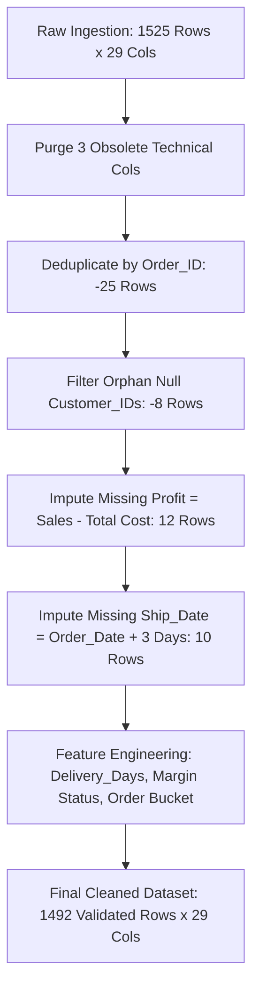

# Task 3: Dataset Selection & Data Preparation Guide

**Student:** Ayush | B.Tech CSE (IoT) | PIEMR, Indore  
**Assignment:** Week 6: Git, GitHub & Final Data Analytics Project  
**Weightage:** 10 Marks  

---

## 1. Domain Selection & Business Rationale
- **Selected Domain:** **Omnichannel E-Commerce & Retail Customer Analytics**
- **Business Context:** Modern retail enterprises generate massive transactional footprints across diverse geographies, customer tiers (Consumer, Corporate, Home Office), and merchandise departments (Technology, Furniture, Office Supplies). Managing logistics turnaround time, price discounting, and category margins is critical for commercial sustainability.
- **Dataset Dimensions:** 1,500 core commercial transactions spanning 2024 to 2026 across 5 Indian macro-regions (North, South, East, West, Central) and 26 analytical attributes.

---

## 2. Pre-Cleaning Defect & Contamination Audit
An initial audit on `raw_ecommerce_sales.csv` (1,525 records x 29 columns) revealed the following data hygiene defects:
1. **Duplicate Records:** 25 duplicated transaction rows sharing identical `Order_ID`s due to distributed ingestion retries.
2. **Missing Shipping Dates:** 10 records missing carrier handover dates (`Ship_Date`).
3. **Missing Profit Values:** 12 records where net margin had not been computed during upstream staging.
4. **Unlinked Customer Foreign Keys:** 8 records with null `Customer_ID`.
5. **Obsolete Technical Columns:** 3 internal database artifacts (`ETL_Batch_ID`, `Sys_Load_Timestamp`, `Legacy_System_Flag`) that add memory overhead without analytical value.

---

## 3. Systematic ETL Cleaning Pipeline

---

## 4. Feature Engineering
- **`Delivery_Days`:** Integer date difference between carrier delivery date and order placement timestamp.
- **`Profitability_Status`:** Categorical tag (`High Margin >= 25%`, `Standard Margin >= 0%`, `Loss-Making < 0%`).
- **`Order_Size_Bucket`:** Transaction scale (`Single Item = 1`, `Multi-Item = 2-5`, `Bulk Order = 6+`).

---

## 5. Post-ETL Validation
- **Missing Values:** Exactly 0 (0.00%)
- **Duplicate Orders:** Exactly 0 (0.00%)
- **Data Retention Rate:** 97.8% (1,492 / 1,525 records retained)
